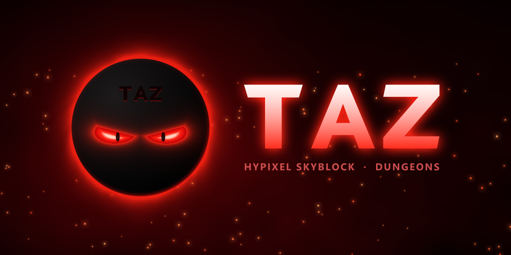

# Taz

mTaz's Hypixel SkyBlock features in one client-side Fabric mod for **Minecraft 26.1.2**, with a SkyHanni-style settings GUI (`/taz`).

| Category | What it does |
|---|---|
| **General** | Alerts (rare drops, bazaar orders, sold auctions, party invites, low health), a Dark Auction reminder, a chat filter, command keys, event timers, a skill XP tracker and waypoints from coordinates in chat. |
| **Inventory** | Lowest BIN and bazaar prices in tooltips, rarity colours behind items, and numbers on items (pet level, book level, minion tier ...). |
| **Slayer** | Boss spawned alert, a box around your own boss, and kill times. |
| **Fishing** | Bite alert, bobber timer, Double Hook alert. |
| **Dungeons** | Run timer and end-time prediction for every Catacombs floor (tuned on M6/M7), live score, splits, PBs, chat and party messages. Secret Routes: Odin waypoint packs for every room, with a guide mode that shows the next step and times each room. |
| **Galatea** | Points at the closest fully grown Fig, Mangrove or Helix tree (pick which types) with a line and a label, so when a tree falls you can go straight to the next. |
| **Honeyhives** (Galatea category) | Highlights the Torrhus Canyon honeyhives you can loot right now, with refill timers and a pointer to the next one. Cosmetic hives are ignored. |
| **Whisper Counter** (Galatea category) | Forest and Desert Whispers per hour in a small HUD, counted only while you're foraging (it pauses 3 seconds after you stop). |
| **More Galatea** | Ruby Veilshroom finder (through rock, respawn timers), tree progress and TIMBER! alert, Sweep Details HUD with a wrong-order warning, Sea Lumies and Lushlilac highlights, hunting mob glows (Hideonleaf, Hideonsun, Shellwise, Coralot, Blue Jay), muted Phantoms, Fairy Soul waypoints and an island guide to every NPC. |
| **SkyBlock XP** | The cheapest SkyBlock XP upgrades you haven't done, a level plan route, a HUD, and an NPC tracker that highlights NPCs through walls. |

## Install

1. Fabric Loader 0.19.5+, **Fabric API** for 26.1.2 and **Fabric Language Kotlin** (the settings GUI library needs it; SkyHanni needs it too, so you likely have it).
2. Put `build/libs/taz-1.0.0.jar` in `mods`. Don't use `taz-1.0.0-slim.jar`; it is missing the settings GUI.
3. **Remove** `dungeon-run-predictor-*.jar` and `skyblock-xp-assist-*.jar`. Taz replaces both, and the game won't start with them installed together.

On first start Taz copies everything from the old mods: run history, triggers and boss lines from `config/dungeonpredictor/`, XP progress and caches from `config/skyblockxpassist/`, and every setting (HUD positions, toggles, API key). The old folders aren't changed.

## Settings

`/taz` is the only command, and it opens the settings GUI (so do Mod Menu and an optional key). **Everything is in there**: every setting, keybind and action of every feature. Categories on the left are areas of the game; **each feature is one collapsed dropdown** in its category, with **Enabled** as its first option, so the menu stays short as features are added. **Every feature starts off**: turn on the ones you want. It works like SkyHanni's: categories on the left, a search bar, and a description for every option. It is [MoulConfig](https://github.com/NotEnoughUpdates/MoulConfig), the same library SkyHanni uses, bundled inside the jar.

- **About:** key to open the menu, **Move HUDs** button and key (Right Shift) for the HUD editor, **Log Galatea HUD text** (on Galatea, each new kind of sidebar, action bar and title line goes into `logs/latest.log` as `[Taz] Galatea ...`, so Taz can learn things like contest points and the Torrhus Springs pressure meter; nothing leaves your computer), reload the settings file.
- **General:** Alerts, Dark Auction Reminder, Chat Filter, Command Keys, Event Timers, Skill Tracker, Chat Waypoints.
- **Inventory:** Item Prices, Item Overlays.
- **Slayer → Slayer Helper** and **Fishing → Fishing Helper**.
- **Dungeons → Run Predictor:** Enabled, Move HUD, Stats, Simple / Everything-on presets, Timer HUD, Score, Chat, Party Chat, Other, **Tools** (pick a floor, then Backtest, Demo run / next / stop, Export history, Reload files, Clear floor history) and **Advanced** (keep HUD after run, history cutoff). Each of these is a dropdown inside Run Predictor.
- **Dungeons → Secret Routes:** Enabled, Mode (Normal / Guide), Taz's routes, Party chat when a room's done, Import from clipboard, Import from Odin, Export, List routes, Remove imported routes, reach distance, show the next step, show hints, path line, Skip and Restart room keys, Reset best times, Move HUD. See [Secret Routes](#secret-routes).
- **Galatea → Next Tree Pointer:** Enabled, **Fig / Mangrove / Helix** (which trees to point at), search radius, a colour per type, and Tree status (counts, next tree, and how long updates take).
- **Galatea → Honeyhives:** Enabled, next hive pointer, refill timers, through walls, colour, Hive status.
- **Galatea → Whisper Counter:** Enabled, show Forest / Desert, pause after (seconds, default 3), Reset counter, Move HUD.
- **Galatea → Tree Progress, Sweep Details, Ruby Veilshroom Finder, Sea Lumies & Lushlilac, Hunting Mobs, Fairy Souls, Island Guide:** see [More Galatea](#more-galatea).
- **SkyBlock XP → XP Assist:** Enabled (turns off the list, HUD, NPC tracker, progress reading and downloads), open the list / plan / NPC finder, next upgrades in chat, stop tracking, **Keybinds** (XP list = K, level plan, NPC finder, toggle HUD, stop tracking), Profile (API key, EliteBot), HUD, XP List (pricing), NPC Tracker, **Progress** (refresh, how to sync, unhide, save next menu, forget seen progress) and **Data Sources**.

Changing the API key, profile or a data source re-downloads your XP data by itself; changing pricing options recalculates the list. Buttons that delete data (Clear floor history, Forget seen progress) need a second click within 5 seconds.

Everything is saved in `config/taz/config.json`, **by itself**: a change is written within a second, even with the settings GUI still open, and again when you leave a server or quit, so you never set anything up twice. Taz also keeps `config.json.last-good` (the last file that loaded fine); if `config.json` is ever damaged (the game killed mid-write, a bad hand edit), Taz puts the good copy back instead of starting from defaults, keeps the damaged one as `config.json.broken-<time>`, and tells you in chat.

## Chat

Everything Taz says in chat starts with **[TAZ]**: its own lines (only you see them) and what features say in party chat (Run Predictor end times, shared coordinates, Secret Routes rooms).

### Chat buttons

Some chat messages have clickable buttons ([Track], [Stop], [Bazaar], [AH], [Recipe], [Open list]). They run `/taz track`, `/taz untrack`, `/taz bz`, `/taz ah`, `/taz recipe` and `/taz list`, so you never need to type them.

## Dungeons

Each run is split into phases from chat (blood rush, blood, clear, portal, and the F6/M6 and F7/M7 boss phases). From the portal on, the end time is the **median of the time left from the same point in your past runs**, weighted towards recent runs, the same teammates, the same number of deaths, and (F7/M7) a similar portal time. Everything is learned in server ticks, so lag stretches the estimate instead of breaking it. Past runs are rebuilt from Minecraft's chat logs on every start, so it knows your runs from before it was installed.

Portal estimate accuracy on the author's runs: **M6 ±2.1s** (91% within 5s), M7 ±26s at the portal, **±7s once the Core opens**. Press Backtest (Dungeons > Tools, floor M7) to replay your own runs and see your numbers.

Files in `config/taz/dungeons/`: `history.json` (runs), `triggers.json` (chat triggers, editable), `boss-lines.log`, `debug-scoreboard.txt`, `history.csv` (after Export history), `secret-routes/` (imported route packs, as Odin files) and `secret-times.json` (each room's best time).

## Secret Routes

Secret waypoints for every Catacombs room, in [Odin](https://github.com/odtheking/Odin)'s dungeon waypoint format, so any Odin pack works. Taz finds the room you're in and how it's turned the way Odin does: each 31-block tile of the dungeon grid is recognised by a hash of the block column at its centre (Odin's room table), and a room's waypoints are stored relative to the blue terracotta corner of its roof, turned to face north. A waypoint lands on the same block in Taz as in Odin.

- **Taz's routes:** Taz comes with a full set (3ppopka's Odin routes, 139 rooms). Turn them off to use only yours.
- **Import from clipboard:** an Odin export (`H4sIA...`, Base64 of gzipped JSON), its plain JSON, or a link to either. **Import from Odin** copies the packs from your Odin install (`config/odin/dungeon-waypoints`). A room in a pack you import uses yours; the newest import wins.
- **Export:** every route in use as an Odin export, to share or load into Odin.
- **Normal** mode draws every waypoint in the room as Odin does (its colour, box size, title; see-through unless the waypoint has depth on).
- **Guide** mode follows the route. It always starts at the red start (`Start · stand on the red block`), then the waypoints titled with a number (`1`, `2 down`, `4 item`, `17 | done`), in order. Only the next step shows, bright, with a line from your crosshair, its distance and what to do there (`Step 4/7 Etherwarp · 6m`, `item · pick up the item`), plus the one after it faintly (`then 5 down`). Waypoints without a number are hints (`if 4 locked`, aim spots, princes, notes) and show faintly nearby. Every waypoint goes away once it's done, steps and hints alike: a secret when it's taken by anyone (a chest's lid opens, a lever flips, an essence skull goes, an item is picked up next to it, a bat dies near it, or the room's `3/7 Secrets` count goes up next to it), a block to mine or blow up (`mine`, `line`, `boom`, `breakwarp`) when it breaks, and a spot when you arrive on it (or on one of the next two, for a step someone else did). A spot that says `bat` or `item` also waits for that secret. The Skip key ticks a step off by hand. Each room is timed from its first secret to its last step (`Mossy done in 0:11.2 (new best, -0.9)`), and your progress lasts the whole run. The Restart room key sends you back to the start. **Party chat when a room's done** says which room you finished and how long it took (`[TAZ] Mossy secrets done in 0:11.2`), unless you're solo. Each room you enter and each waypoint done is written to the game log (`[Secret Routes] ...`). Rooms without a red start (puzzles, Blood, Entrance) start at step 1 when you walk in.

The routes follow 3ppopka's legend, which Taz reads for any pack (an Odin waypoint type, when set, wins over the colour):

| Colour | Means |
|---|---|
| Red | Start point |
| Purple | Etherwarp to this block (see-through: text to read) |
| Green | Chest, lever or wither essence |
| Yellow | Where to aim a normal teleport |
| Aqua | Prince |

| Note | Means |
|---|---|
| `bat` | Stand on this block and kill the bat with Hyperion |
| `just tp`, `normal` | Aim here and right-click to teleport (not etherwarp) |
| `down`, `forward`, `up`, ... | Which way to move or mine |
| `line` | Mine only the line (usually with a normal teleport) |
| `breakwarp` | Teleport normally, break the block, then etherwarp |

## Galatea next-tree pointer

On Galatea (Moonglade Marsh) and Torrhus Canyon, a line from your crosshair and a `Next: Mangrove 23m (84 logs)` label point at the closest **fully grown** tree of the types you picked. Trees themselves aren't highlighted.

Tree logs are real blocks (Fig = stripped spruce wood, Mangrove = mangrove wood, Helix = stripped birch + stripped mangrove wood), so Taz groups touching logs into trees and watches them change:

- **Chopped:** logs were broken (by anyone) and haven't grown back, or a `FIG TREE 42%` progress hologram is on it.
- **Regrowing:** logs are coming back right now.
- **Grown:** nothing has changed for 3.5s and the tree was never touched, grew back after being chopped, or is still at least 97% of its grown size.

It only reads chunks within the search radius (default 96 blocks), a few per tick, and when logs change it regroups only the trees they touch. In a stress test with ~35,000 logs being chopped every tick, it takes under 1 ms in the worst tick (it was ~17 ms before).

A tree that was already half-chopped before you arrived looks grown until someone touches it or its hologram shows. The island comes from the tab list's `Area:` line, so keep that widget on.

## Honeyhives

In Torrhus Canyon, every honeyhive you can loot right now gets a box (gold by default) **from anywhere on the island**, and a line from your crosshair plus `Next hive: 23m` points at the closest one. Far away, each cluster gets one label (`3 honeyhives ready`, or `Refill in 34m`).

- **Known in advance:** hives sit in 8 clusters of 2-3. Their positions ship with Taz (`assets/taz/foraging/honeyhives.json`), and every hive found in game is added to `config/taz/foraging/honeyhives.json` for all profiles. A cluster with no known hive yet gets a beam and `Honeyhives here (walk here once to map them)`; once you've been near it, its hives are exact for good.
- **Only real hives:** each lootable hive has a `Honeyhive` hologram over it; cosmetic hives don't, so they're never highlighted.
- **Ready or not:** a hive is ready when its hologram has no `Refill in: 59m 46s` line (it says `Click to loot!`). The hive is found as the block under the hologram, whatever block it is.
- **Ready unless you looted it:** refill timers are per player, so a hive counts as ready until you loot it. Each loot is remembered per profile until its time is up (the hologram corrects the time when you're near), also after you leave and come back.
- **Chat:** your `You stick your hand into the honeyhive...` loot message and `QUEEN BEE! The Honeyhive instantly refilled with loot!` update the hive you're at straight away.

## More Galatea

Moonglade Marsh and Torrhus Canyon, from the 0.27 patch notes, the wiki and the chat lines in your own game logs. The Torrhus ones work out which island you're on from your position (Torrhus Canyon is the part past z 100).

- **Tree Route Assist:** your tree route, imported from Skyblocker: copy it there (Waypoints, Share, Export: `[Skyblocker-Waypoint-Data-V1]...`) and press **Import from clipboard**. A route only shows on its island (Skyblocker's island ids, `foraging_3` = Torrhus Canyon); one made for no island gets the island you're standing on, or, on Galatea, the island its points are on. Point names say what they are: `3` is a tree, `E3` an etherwarp spot, `TP3` a teleport, anything else a stop (`Miria`). **Normal** mode shows the whole route, numbered, with path lines. **Guide** mode goes one tree at a time: only the next tree shows (box, beam, `Tree 4 · 35m`), with the warps and teleports that get you there numbered on a path from your crosshair (`1. Etherwarp E4`, `2. Etherwarp E5`); each ticks off when you reach it. At the tree it says `Chop Tree 4` and shows where to go after (`then Etherwarp E5`); the next tree comes up when this one is done (your `You helped cut 100% of the Fig Tree.` or `TIMBER!` message, or its logs gone) or when you leave it. A tree that isn't grown when you get there, or says it's regenerating, is skipped by itself (`Skipped Tree 4 (not grown)`). **End stops after the last tree** (off by default) turns the teleports and stops after your last tree (`TP1`..., `Miria`) on or off; off, the lap ends at the last tree and starts straight over at Tree 1. Laps are timed from the first tree, with a split at every tree against your best (`Tree 3 -1.2s`). Best laps are kept per route. Restart and Skip keys, Export back to Skyblocker's format, several routes per island (Next route here).
- **Pressure Warning:** a `PRESSURE 85%` title when Torrhus Springs' `Pressure: N%` (action bar) reaches your limit (80% by default), again after you swim back up.
- **Ruby Veilshroom Finder:** Ruby Veilshrooms are crimson fungus blocks in the caves at the bottom of Torrhus Springs (dive down at -646 161 200, past Hotspot Haven and Ant's Cave). The client has the whole cave in its chunks, so Taz finds every one **from anywhere on the island, through the rock**, boxes it, and points at the closest (`Next veilshroom: 23m`). A picked one shows `Respawns in ~37s` (they come back after 50-55 seconds) and, with none ready, the pointer goes to the one back soonest. Before you've ever found one, a beam marks where to dive. Every spot seen is kept in `config/taz/foraging/veilshrooms.json`. HUD: ready / respawning, picked (each gives 4) and per hour.
- **Tree Progress:** the `FIG TREE 37%` hologram of the tree you're chopping in a HUD, a `TIMBER!` title when `TIMBER! You felled the entire Fig Tree!` comes in, and trees felled per type and per hour of chopping.
- **Sweep Details:** Hypixel's `Sweep Details` chat block (sweep, tree toughness, logs, axe-throw and wrong-style penalties) as a HUD instead of chat, and a `WRONG ORDER -50%` title with the right order (Fig: trunk first; Mangrove: branches, trunk, roots; Helix: beige before red).
- **Sea Lumies & Lushlilac:** boxes round Sea Lumies (sea pickles in Murkwater Shallows / Depths, only clumps of 3+ by default; they give Foraging XP) and Lushlilac (flowering azalea on the Reaches and Verdant Summit), with an optional pointer.
- **Hunting Mobs:** Hideonleaf (green shulkers), Hideonsun (yellow / orange / brown shulkers), Shellwise (turtles), Coralot (axolotls) and Blue Jays (blue parrots) glow through walls, each in its own colour. Phantoms can be muted on Galatea.
- **Fairy Souls:** the 12 Moonglade Marsh and 12 Torrhus Canyon souls you haven't found, with a beam, a hint (`Behind a waterfall`) and a pointer to the closest. `SOUL! You found a Fairy Soul!` ticks off the one you're at (per profile, in `config/taz/foraging/fairysouls.json`); Mark all found / Forget found buttons.
- **Tree Gifts & Loot:** counts Tree Gifts per tree, Bonus Gifts, `KARMA!` double loot, mobs that fall out (`A Phanpyre fell from the Tree!`), honeyhive Honeycomb (`HIVE! You found Honeycomb x30 ...`) and today's HOTF Lottery buff (`New buff: Gain +50 Fig Fortune.`) in a HUD. Each 10-line `TREE GIFT` block becomes one line (`TREE GIFT Fig 100% · +5 rewards · KARMA x2 · BONUS Hummingbird Shard (0.15%) · Phanpyre!`, rewards on hover), a Bonus Gift drop at or below 1% gets a title, and `You cannot damage a tree while it is regenerating!` is hidden.
- **Starlyn Contests:** a new contest runs every SkyBlock day and ends 30 seconds before the day does (at :14:30, :34:30 and :54:30; the sidebar's `Agatha's Contest 14m55s` is used when it's showing), so the HUD shows `Agatha's Contest 12:34 left` (Miria on Torrhus Canyon) with your live bracket from the sidebar (`RARE with 1.2k · Epic requires +1.3k`), your last score from `You earned a total of 4,999 points!` with its bracket and how far the next is, and what you claimed this session. The `STARLYN CONTEST REWARDS CLAIMED` blocks become one line: `Claimed 2 Agatha contests: 45 Agatha's Coupon, 17,500 Forest Whispers, ...`. Optional alert a minute before a contest ends.
- **Protected trees (Next Tree Pointer):** when the Tree Protection Agency fines you 1,000 coins, a `PROTECTED TREE` title comes up and the tree you hit is remembered for good (`config/taz/foraging/protected-trees.json`): the pointer never sends you there again. A tree Hypixel says is still regenerating is skipped for 30 seconds.
- **Island Guide:** pick an NPC or spot (Agatha, Swoop, Rosemary, Kysha, Jade Dragon, Torrhus Springs, Dory, Ant, Hunter McNeil, Miria, Helia, Honey, Beekeeper Bartholomew, Forager Daniel, Freddy, Sanger, Maxim, Andrea, Archie, Safari Manager) and get a beam and pointer there; it clears when you arrive.

## General

- **Alerts:** a big title and a sound for `RARE DROP!` / `VERY RARE DROP!` / `CRAZY RARE DROP!` / `PET DROP!` (pick every drop or only the rarer ones), filled bazaar orders, sold auctions, party invites, and low health (below 25% of your max by default, from the action bar). Players typing those words in chat don't trigger it.
- **Dark Auction Reminder:** a title, a sound and `Dark Auction in 3m 0s! [Warp]` before every Dark Auction (they start at :55 every hour), and again when it starts. The minutes before, the sound and the [Warp] button (`/warp da`) are settings.
- **Chat Filter:** hides lobby joins, Watchdog announcements, warping / profile messages, ability damage, ability errors, kill combo and (optional) friend / guild joins and Autopet. Taz features still read every line.
- **Command Keys:** 8 keys, each with any command (`/pets`, `/storage`, `/warp garden` ...) or chat message. All start unbound.
- **Event Timers:** a HUD counting down to the Dark Auction, Jacob's Contest, Cult of the Fallen Star, Spooky Festival, Season of Jerry, bank interest, Traveling Zoo and New Year (pick which by dragging), worked out from SkyBlock's calendar, with optional reminders and the SkyBlock date.
- **Skill Tracker:** skill XP per hour and time to your next level from the `+12.5 Foraging (52,312/100,000)` action bar messages (percent display works too). Like the whisper counter, the clock only runs while you're getting XP.
- **Chat Waypoints:** `x: 12, y: 70, z: -5` (or `12 70 -5`) in party chat becomes a beam you can walk to; elsewhere it gets a [Waypoint] button. Waypoints go away when you reach them or after 10 minutes. A key sends your own coordinates to party chat.

## Inventory

- **Item Prices:** `Lowest BIN: 900M` or `Bazaar buy: 1.7K sell: 1.5K` at the bottom of every SkyBlock item's tooltip, with the whole stack's price. Enchanted books are priced by their enchant and pets by level and rarity. Uses the prices SkyBlock XP Assist already downloads, or downloads them itself every 15 minutes.
- **Item Overlays:** the rarity colour behind items in every inventory and menu (Common skipped by default), and a small number on pets (level), enchanted books (level), minions (tier), skills and collections in menus (level) and New Year Cakes (year).

## Slayer and Fishing

- **Slayer Helper:** Hypixel puts `Spawned by: <name>` over every slayer boss, so Taz knows which one is yours: a `BOSS SPAWNED` title, a box around it (through walls), and `Boss killed in 0:42 (best 0:38, average 0:45, 12 this session)` after `SLAYER QUEST COMPLETE!`.
- **Fishing Helper:** a `!!!` title and sound the moment a fish bites (Hypixel's `!!!` over your bobber), seconds since you cast over your bobber, and a Double Hook title.

## Whisper Counter

A small HUD on Galatea and Torrhus Canyon:

```
Whispers (counting)
Forest 209,597/h +1,240
Desert  12,677/h +75
Foraging 0:21
```

- **Whispers gained** come from the totals in the tab list (`Forest Whispers: 12,345`, `Desert Whispers: ...`), so every source counts. Spending whispers isn't a loss, switching lobby or profile starts from the new totals instead of counting the jump, and the refund when you reset your Heart of the Forest (`You have reset your Heart of the Forest!`) isn't counted as whispers earned.
- **Only while foraging:** the clock runs while you hit logs, logs break within 7 blocks of you, or whispers come in. 3 seconds after the last of those it says **(paused)** and stops, so the rate is per hour of foraging, not per hour online. The pause time is a setting.
- The rate shows after 10 seconds of foraging. **Reset counter** starts again from zero.
- Needs the tab list's Forest / Desert Whispers lines (and the `Area:` line) turned on in Hypixel's tab list widgets.

## Moving HUDs

HUDs and in-world labels (waypoints, tree pointer, honeyhives) are plain shadowed text with no background box. Every Taz HUD (dungeon panels, SkyBlock XP, Whisper Counter, Event Timers, Skill Tracker) moves in one editor: **Right Shift**, About → Move HUDs, or any feature's Move HUD button. Drag to move (it snaps to the screen edges and centre), scroll to resize, right-click to hide or show, R to reset the one under the mouse, arrow keys to nudge the last one you touched. **Reset all** puts every HUD back. Positions are saved as you go.

## SkyBlock XP

- **Cheapest XP list** (`K`, or the button in /taz): every upgrade you haven't done (museum, unique minions, Abiphone contacts, accessories, pets, consumables, essence shop perks, misc), sorted by coins per SkyBlock XP, with buy buttons for the Bazaar, Auction House and recipes.
- **Level Plan** (button or keybind; plan length is the "Plan levels" slider): the cheapest way to your next levels as a route, one stop per NPC grouped by island, with what to bring.
- **HUD:** your level, the next cheapest upgrades, shopping hints near planned NPCs, and free XP you're carrying ("Ready to donate").
- **NPC tracker:** the NPC glows through walls and gets a box, beam and label. Use the NPC Finder (search an NPC, or an item to find who sells it) or a [Track] button in chat.
- **Progress** is read live from the `+N SkyBlock XP` messages and Hypixel's menus, and loaded from EliteBot (no key needed) or the Hypixel API with your own key. Saved per profile in `config/taz/xpassist/progress.json`.

All game data (prices, NPCs, recipes, museum XP) is downloaded live and cached in `config/taz/xpassist/cache/`. The few rules no API exposes are in `assets/taz/xpassist/rules.json`; copy it to `config/taz/xpassist/rules.json` to override.

## Code layout

```
com.taz
├── Taz, TazCommand          startup, /taz (settings GUI + chat-button actions)
├── util/                    KeyWatcher (GUI keybinds), TazChat ([TAZ] chat and party chat, click-twice confirm), Alert (title + sound)
├── config/                  TazConfig (one @Category per area), AboutConfig, Migration (old mods → Taz), ConfigSafety (last good copy)
├── render/WorldRenderer     boxes, lines and labels in the world (through walls or not), shared by every feature
├── hud/                     MovableHud, TextHud, TazHud (draws every HUD), TazHudEditor (moves them all)
├── general/                 Alerts, DarkAuctionReminder, ChatFilter, CommandKeys, EventTimers (+ SkyblockEvent calendar), SkillTracker, Waypoints
├── inventory/               ItemPrices + PriceTooltips, ItemOverlays
├── slayer/, fishing/        SlayerHelper, FishingHelper
├── dungeons/                Dungeons: run tracker, predictor, score, HUD panels, DungeonTools (Tools buttons)
│   └── secrets/             DungeonRooms (room + rotation, Odin's way), SecretRoutes (Odin packs), SecretTrainer (Secret Routes)
├── foraging/                Galatea: TreeTracker + TreeRenderer (tree pointer), HoneyhiveTracker + HoneyhiveRenderer (honeyhives), WhisperTracker + WhisperHud,
│                            BlockFinder (every block of a kind in loaded chunks), RubyVeilshrooms, TreeProgress, SweepDetails, MoongladeResources,
│                            HuntingMobs, FairySouls, IslandGuide, TreeGifts, StarlynContest, ProtectedTrees, GalateaRecorder, PressureWarning,
│                            TreeRoutes + RouteAssist (Tree Route Assist, Skyblocker format), Islands (island ids), Galatea (which island)
├── xpassist/                SkyBlock XP: data sources, XP calculator, screens, HUD, NPC tracker, XpActions (buttons)
├── mixin/                   chat packets, server time, block changes, container clicks, action bar, glow
└── compat/                  Mod Menu
```

**Adding a feature:** put it in its own package, give it a config class with MoulConfig `@ConfigOption` fields (`@Expose` on everything that should be saved) whose first option is `enabled`, add it as an `@Accordion` field to its category class (`GeneralCategory`, `InventoryCategory`, `DungeonsCategory`, `SlayerCategory`, `FishingCategory`, `GalateaCategory`, `SkyblockXpCategory`, or a new category in `TazConfig`), and start it from `Taz.onInitializeClient`. Group sub-settings as nested `@Accordion` classes (MoulConfig won't mix those with `@ConfigAccordionId` in one class). Its `enabled` starts `false` (no feature is on by default). If saved settings move, bump `TazConfig.CURRENT_VERSION` and add the move to `Migration.upgradeConfigFile` (the old file is kept as `config.json.bak-v<N>`). No new commands: actions are `@ConfigEditorButton` Runnables, keys are `@ConfigEditorKeybind` ints read with `KeyWatcher`. Draw world highlights with `WorldRenderer`. **Every HUD must be movable:** make it a `MovableHud` (a `TextHud` for plain text lines, saved in a `HudPos` field of its config) and `TazHud.register` it, so it shows up in the HUD editor. HUD text has no background box (shadowed text only). Chat lines, action bar messages and ticks reach features through `Taz.onSystemChat`, `Taz.onActionBar` and `Taz.tick`, each wrapped in `safely(...)` so one broken feature never stops the others.

## Credits

Secret Routes uses Odin's dungeon room table (`assets/taz/dungeons/rooms.json`) and follows Odin's room scanning, so Odin waypoint packs line up. Odin is © odtheking, under the BSD 3-Clause License (included as `assets/taz/dungeons/odin-LICENSE.txt`). The secret routes Taz comes with are 3ppopka's (inspired by flameofwar), shared as an Odin waypoint pack.

## Source and history

The code is in git (`main`), with a commit per change, so the history shows how the mod was built. `.gitattributes` keeps `gradlew` working on every OS.

## Build and test

JDK 25 · Minecraft 26.1.2 (Mojang names) · Fabric Loader 0.19.5 · Fabric API 0.155.3+26.1.2 · Loom 1.18.4 · Shadow 9.6.1 · MoulConfig 4.8.0 (modern-26.1) · Fabric Language Kotlin 1.13.12.

```
gradlew build                 # build/libs/taz-1.0.0.jar
gradlew runClient             # dev client
gradlew runClientGameTest     # in-game tests, screenshots in build/run/clientGameTest/screenshots
gradlew runClientGameTest -Ptests=honeyhive   # only one feature's tests (honeyhive, trees, xp, settings, whispers, general, galatea, secrets)
gradlew runClientGameTest -Ptests=slayer      # one part of the general test (autosave, alerts, chatfilter, commandkeys, events,
                                              # darkauction, skills, waypoints, huds, prices, overlays, slayer, fishing)
gradlew runBacktest           # dev: replay run/config/taz/dungeons/history.json, writes backtest.txt
```

The in-game tests open a singleplayer world and check: the XP list, plan and NPC finder screens and the NPC marker through a wall; progress detection from menus and action-bar XP; fake Galatea trees being chopped, hologram-marked, felled and regrown, picking tree types, a 35,000-log forest stress test of the tracker's speed; every settings GUI category, that /taz is the only command, a GUI keybind, and importing the old mods' settings; the whisper counter's rates, pause and spending, and dragging its HUD in the HUD editor; settings auto-save and restoring a damaged settings file; every alert, the Dark Auction reminder, the chat filter, command keys, the SkyBlock calendar and reminders, the skill tracker, chat waypoints, price tooltips, item overlays, the slayer boss and the fishing bite; Ruby Veilshrooms found by block changes and by scanning chunks (also underground), picked and respawned, tree progress and TIMBER!, sweep details, Sea Lumies and Lushlilac, hunting mob glows and muted Phantoms, Fairy Souls ticked off, and the island guide; a Tree Gift block (from the game log) counted and shrunk to one line with its hover, rare bonus alert, honeycomb and Lottery buff; Starlyn reward claims added up, score bracket and contest end; a protected tree skipped by the pointer and a regenerating one too; and the HUD-text recorder; a HOTF reset refund left out of the whisper counter; contests ending 30 seconds before the SkyBlock day and the sidebar timer and bracket; the pressure warning; and Tree Route Assist (your real Skyblocker export imported to Torrhus Canyon with 37 points, exported back the same, a guided lap timed with splits, a tree that isn't grown and a regenerating one skipped, leaving a tree, laps with and without the end stops, the restart key); and Secret Routes (Odin's room table and Taz's routes read, the four room rotations and every room shape's corner, a room built on the dungeon grid found by its core and turned the right way, an Odin export landing on the right blocks, the route legend (colours and notes), a guided room from its red start through an etherwarp spot, a chest (which starts the timer), a bat spot that waits for the bat, a yellow aim spot that isn't a step, a slab-sized spot, a mined block, a mining hint cleared and a lever, the secret count, a chest a teammate opens and picked-up Paper, the restart key, export and Odin-folder import, Normal mode and the settings).
